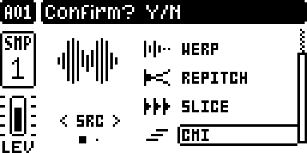
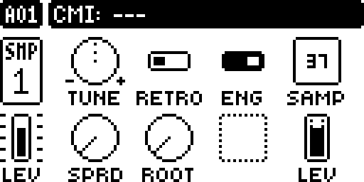
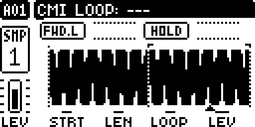
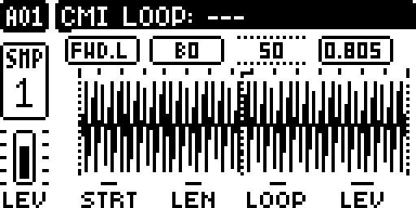

# Digi CMI

A Fairlight CMI-style polyphonic sample instrument for the original Digitakt (mk1), as an
[elekloader](https://github.com/elekloader/elekloader) mod. Track 1 becomes one 8-voice instrument that plays a
single sample across the keyboard, with CMI-style loop controls, a RETRO mode that plays the sample the way an
early CMI voice did, stereo spread and a time synth that builds a moving wavetable from the sample itself.

> **Unofficial and unsupported. Not affiliated with, endorsed by or supported by Elektron or Fairlight.
> Flashing modified firmware is at your own risk.** elekloader never touches the bootloader: flashing your
> official OS file always restores the unit. Go back to the official OS before contacting Elektron support.

## Overview

- **Machine CMI** (id 40) in the FUNC+SRC machine list, on **track 1 only**. With CMI on track 1, tracks 2-8
  become its voices: their machines can't be changed and their own trigs are silent until track 1 plays another
  machine. Hold FUNC and the track keys turn blue.
- **One sample, eight voices.** Notes from track 1's trigs (and chords) and from MIDI on any track's channel
  play the sample pitched from **C3 (MIDI 60)**, one voice each. Velocity sets volume (the stock curve).
  When more than eight notes sound, the quietest voice is taken.
- **Loop controls** after the CMI's: forward, reverse and ping-pong loops between LOOP and the sample's END,
  HOLD or SUSTAIN looping. Loops play at the note's pitch, so higher notes loop faster, and
  loop points follow knobs, p-locks and LFOs while notes sound.
- **RETRO**: 8 bits at 24 kHz with the CMI Series I's rate character (each voice's clock follows its pitch).
- **SPRD**: stereo spread; at 127 notes alternate hard left and hard right.
- **ENG = TIME**: a time-domain wavetable synth. Sixteen single cycles are cut from the sample between STRT
  and END and played in turn while the note sounds, stepped or crossfaded, optionally smeared together, with
  the same loop layout as the sample (PLAY and LOOP). The sample's pitch is detected automatically (or set with
  ROOT), so each cut is exactly one cycle and the root plays at the sample's own pitch, as in sample mode.
- A Digitakt II-style **waveform page** (page 2) with dotted markers and a playhead arrow for each sounding note.

## Controls

Page 1 (SRC):

| Knob | Name | What it does |
|---|---|---|
| A | TUNE | Pitch, as ONESHOT |
| B | RETRO | Switch: off, or 8-bit 24 kHz with CMI-style rate |
| C | ENG | Switch: SMPL (the sample) or TIME (the time synth) |
| D | SAMP | Sample slot |
| E | SPRD | Stereo spread: 0 centred, 127 alternate notes hard left / hard right |
| F | ROOT | Time synth only: AUTO (default) finds the sample's pitch, or set the note it was recorded at. The pop-up shows what AUTO found ("AUTO G2"; "AUTO (NONE)" when it finds none and uses C3) |
| H | LEV | Level |

Page 2 (press SRC again), with ENG = SMPL:

| Knob | Name | What it does |
|---|---|---|
| A | PLAY | REV, REV.L, FWD.L, FWD, P (ping-pong loop) |
| C | LMOD | HOLD: loop for as long as the voice sounds. SUS: loop while the note is held, then play on to the end |
| E | STRT | Sample start |
| F | LEN | Sample length (END = STRT + LEN) |
| G | LOOP | Loop start (the loop runs to END) |
| H | LEV | Level |

Page 2 with ENG = TIME:

| Knob | Name | What it does |
|---|---|---|
| A | PLAY | As for the sample, over the 16 waves: FWD and REV play through once; FWD.L plays first to last, then loops from LOOP's wave to the last; REV.L loops from the last down to LOOP's; P plays first to last, then back and forth between the last and LOOP's |
| B | BLND | 0 steps from wave to wave (CMI segments); 127 crossfades all the way |
| C | SMEAR | Mixes each wave with its neighbours, up to all of them; 0 off (shares LMOD's value) |
| D | TIME | Time of one pass from the first wave to the last, 0.05 s to about 13 s, shown in seconds |
| E, F | STRT, LEN | The part of the sample the waves are cut from |
| G | LOOP | Where the loop starts, between STRT and END (shown on the waveform) |
| H | LEV | Level |

CCs: BLND 24, LMOD/SMEAR 25, SPRD 26, TIME 27, RETRO 28, ENG 29, ROOT 30. The other knobs keep ONESHOT's CCs.

## Usage

1. On track 1, open the machine list (FUNC+SRC), choose **CMI** and confirm. Tracks 2-8 are now its voices.
2. Press SRC, set **SAMP** to a sample whose root is C3, and play: trigs on track 1, chords from its TRIG page,
   or a MIDI keyboard on any track's channel.
3. Press SRC again for the waveform page. Set PLAY to FWD.L, REV.L or P and move LOOP to loop the tail;
   LMOD SUS loops only while a key is held.
4. Back on page 1, turn RETRO on for the CMI's 8-bit grit, or SPRD up to spread notes across the stereo field.
5. For the time synth, set ENG to TIME, choose the region with STRT/LEN, the speed with TIME and the looping
   with PLAY and LOOP, and shape the movement with BLND and SMEAR. If the pitch sounds wrong, set ROOT on page 1.

## Compatibility and limitations

- **Digitakt mk1, OS 1.54.** Built against 1.54; the OS 1.53 addresses are only partly checked, so 1.53 is untested.
- Needs elekloader's **core** (built with 4.3) and **machine-pages** (1.10).
- **Conflicts** (same patch sites or sound slots): Digi Poly, dt8poly, DIGISLICER, Digi EQ, Digi Matrix.
- CMI can only be chosen on track 1 and uses all eight tracks as voices while it is there.
- In sample mode the sample plays unpitched on C3 (MIDI 60), as stock; use TUNE to correct a sample recorded at another pitch.
- TIME's pitch detection suits pitched, steady sounds. Drums, noise, bells and sounds with vibrato or glides can be
  detected an octave out or not at all (then C3 is used): set ROOT (page 1) by hand for those.
- SMEAR shares its stored value with LMOD, and TIME with the knob that was LFIN before 0.20, so a value set in
  one engine carries over when you switch ENG.
- TIME scales its waves to near full level, so a quiet sample plays louder in TIME than in SMPL.
- SMEAR is set per track (from track 1's value) and acts when the knob moves; p-locks and LFOs don't change it per note.
- Kits saved with CMI load that track as ONESHOT on the stock OS.

## Tests and measurements

Measured in [digiemu](https://github.com/irpina/digiemu) on OS 1.54 (`tests/digiemu_poly.py`):

- Loop modes: windows, wraps, ping-pong turns, SUS release-to-end; loop laps scale with pitch
  (E ×1.260, G ×1.498, B ×1.888 against C).
- RETRO: every value on the 8-bit grid; held-sample share follows the 24 kHz clock model.
- SPRD at 127: notes alternate hard left and hard right at full level (stereo output read from the emulated SSI).
- TIME loops (0.20): with LOOP halfway (wave 7.5), FWD.L jumps back to it after the last wave, REV.L from it to
  the last, and P bounces between it and the last.
- TIME pitch detection (0.19): a 440 Hz sine and a 196 Hz saw are found and play at 440.4 / 195.9 Hz on MIDI 60;
  ROOT = C3 forces 262.3 Hz; noise finds no pitch and falls back to C3.
- Voice stealing always takes the quietest eligible voice; every voice gets its own note's velocity.

Hardware: builds up to 0.14 were run on the author's Digitakt mk1 during development, and the faults found
there were fixed in 0.9-0.16. **0.17-0.20 have only been run in digiemu.** BLND and SMEAR have not been
checked by ear, and CPU load with eight time-synth voices has not been measured.

## Building

You need elekloader and your own official OS file (`Digitakt_OS1.54.syx`, from Elektron). No firmware is
included here.

```bash
python3 -m elekloader.sdk.build mods/digicmi --stock Digitakt_OS1.54.syx --out build
python3 -m elekloader.patch --stock Digitakt_OS1.54.syx --mod core-4.3-os1.54.elemod --mod machine-pages-1.10-os1.54.elemod --mod build/digicmi-0.20-os1.54.elemod --out digicmi.syx
```

Then send the `.syx` with Elektron Transfer.

## Authorship and licences

- **Digi CMI**: neutronrabbit, with Claude (Anthropic) as coding assistant. MIT, see [LICENSE](LICENSE).
- Forked from **Digi Poly 2.1** by gdeo607 and the digi1_mods authors
  ([gdeo607/digi1_mods](https://github.com/gdeo607/digi1_mods) at `32fd22a1fd66fa5833b808b1c1c049a0deb82d88`,
  see `mods/digicmi/UPSTREAM`): the polyphony, voice borrowing and kit storage come from it. Its MIT licence is
  kept in [LICENSE-digi1_mods](LICENSE-digi1_mods).
- Built on [elekloader](https://github.com/elekloader/elekloader) and its core and machine-pages mods.
- "CMI" refers to the Fairlight CMI, whose looping, waveform synthesis and 8-bit sound this mod is modelled on.
  No Fairlight code, samples or artwork are used.

## Screens

All captures are from digiemu (the emulator's LCD, 4× scale), not photos of a unit.

| | |
|---|---|
|  |  |
| Machine list, CMI selected on track 1 (0.10; unchanged since) | Page 1: TUNE, RETRO, ENG, SAMP / SPRD, ROOT, LEV (0.20) |
|  |  |
| Page 2, FWD.L loop, a note's playhead arrow (0.20) | Page 2 with ENG = TIME on a 196 Hz saw: BLND, SMEAR, TIME, the 16 waves' places and LOOP (0.20) |

## History

Each version is a tagged commit (`v0.1` ... `v0.20`); see [CHANGELOG.md](CHANGELOG.md). The source of earlier
versions was reconstructed from the development session and checked against the source hashes recorded in each
built `.elemod` (0.11 against its flashed firmware); 0.4 and 0.5 match in compiled code but differ from the
built files in some comment text.
